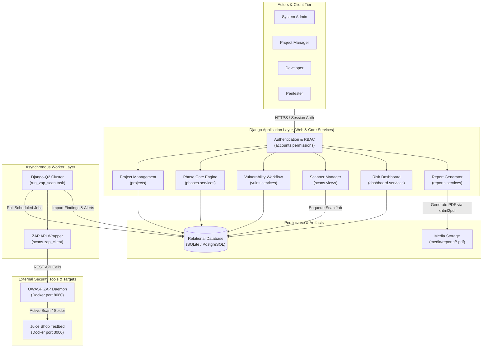
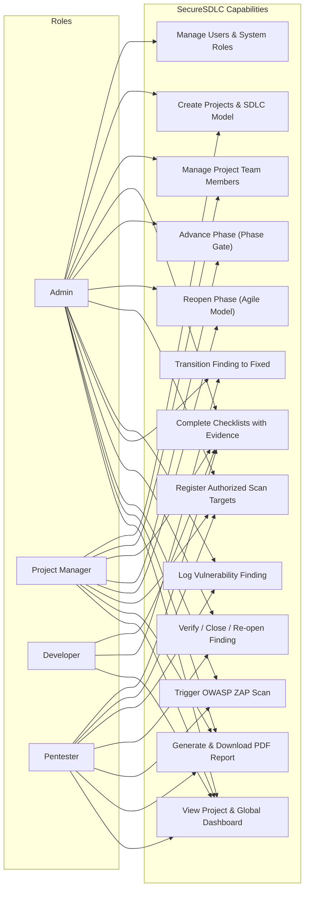
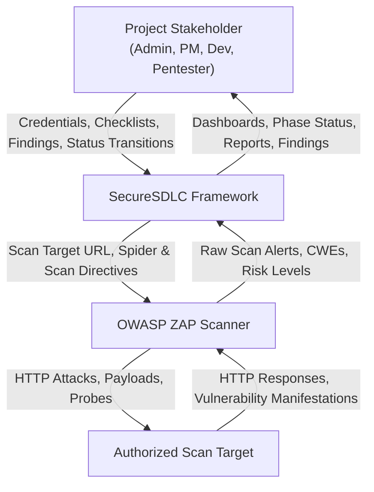
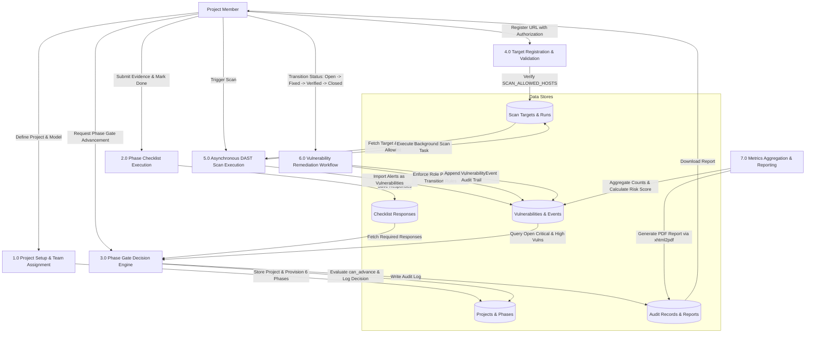
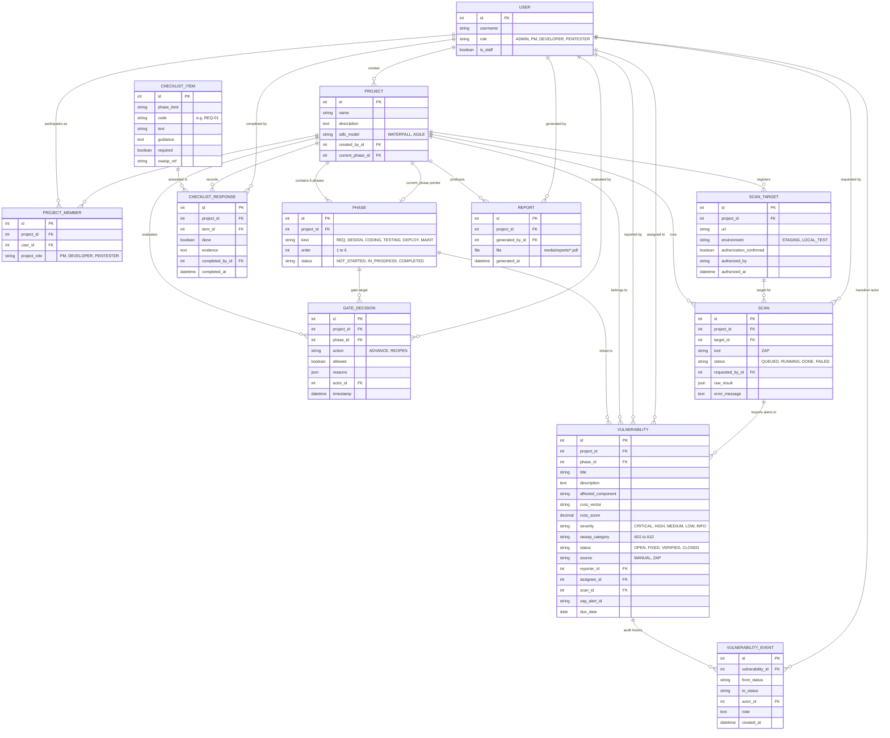
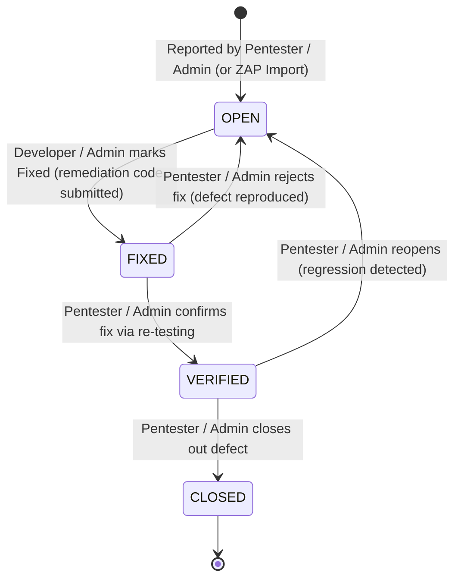
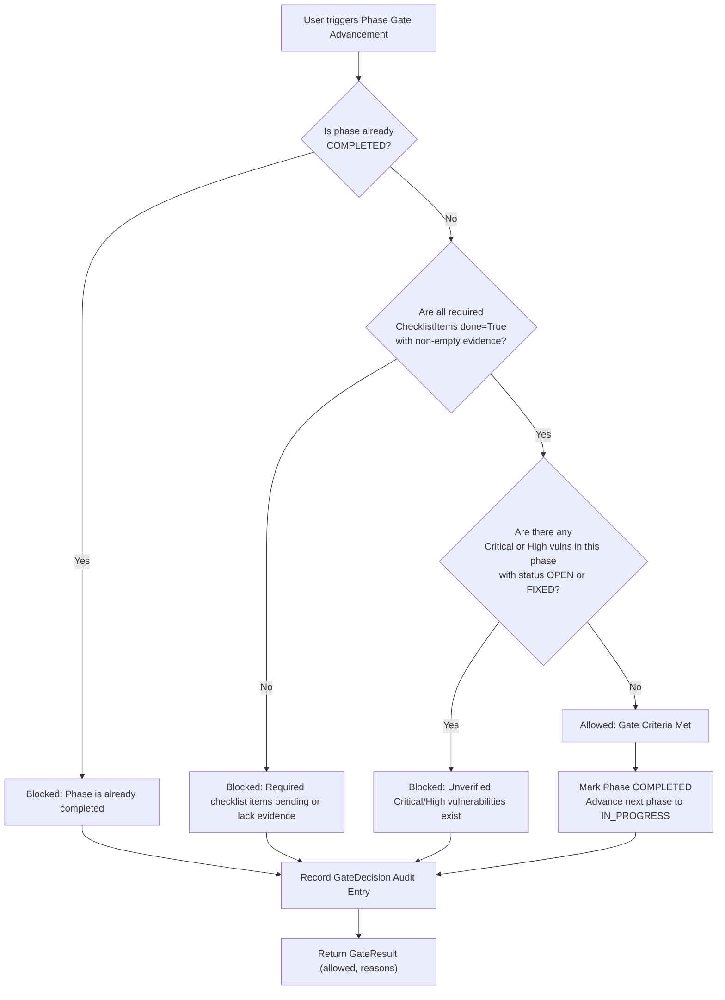

# Chapter 3: System Architecture & Design

This document details the architectural design, security model, entity relationships, and data workflows of the SecureSDLC Framework, aligning directly with Sections 3, 4, and 5 of `CLAUDE.md`.

---

## 1. High-Level Framework Architecture

The SecureSDLC framework enforces shift-left security and continuous penetration testing throughout all six software development lifecycle phases.

---

## 2. Role-Based Access Control (RBAC) & Use Case Diagram

The system specifies four roles with strictly partitioned capabilities (CLAUDE.md §3).

---

## 3. Data Flow Diagram (DFD)

### Level 0 Context Diagram

### Level 1 Data Flow Diagram (Core Workflows)

---

## 4. Entity-Relationship Diagram (ERD)

The data model follows CLAUDE.md §4, providing full referential integrity and timestamp tracking.

---

## 5. Vulnerability Remediation Lifecycle State Machine

Implemented strictly in `vulns/services.py::transition()` (CLAUDE.md §5.3):

---

## 6. Phase Gate Decision Logic

Implemented strictly in `phases/services.py::can_advance()` (CLAUDE.md §5.1):

